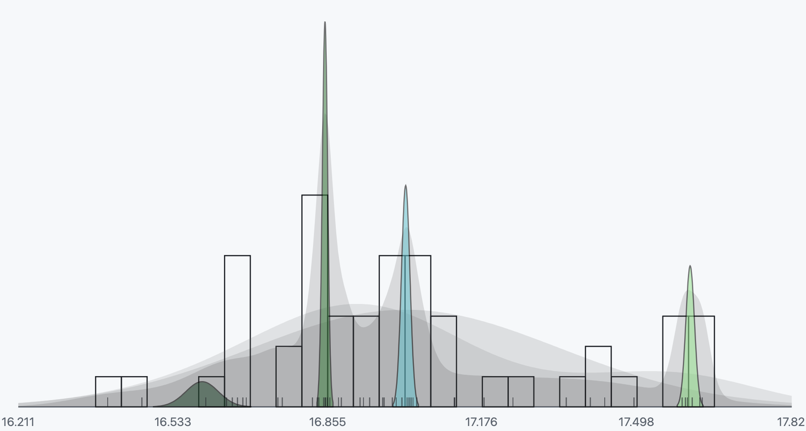

# pkft: Peakfit Explorer

📚 See the [documentation](https://pkft.readthedocs.io/en/latest/) for details.

Peak finding for 1D data with uncertainties by discrete Gaussian mixture
modelling (Galbraith & Laslett, 1993) in the spirit of IsoplotR
`peakfit` (Vermeesch, 2018), served as a FastAPI service with a minimal
dependency-free web UI.



*Figure: mixture fit for the bundled Trayler et al. 2020 demo dataset.*

## Prerequisite software

This project is written in [python](https://www.python.org). For most users, I recommend installing the [miniforge](https://github.com/conda-forge/miniforge) python distribution. This distributions includes a minimal installation of python and the package manager [conda](https://docs.conda.io/en/latest/), which is required to build the necessary python environment for this software.

For macOS users, miniforge can be installed with [homebrew](https://brew.sh):

```bash
brew install miniforge
```

For Window's users, miniforge can be installed from a binary .exe. Follow the instructions for miniconda, anaconda, or miniforge (recommended) [here](https://docs.conda.io/projects/conda/en/stable/user-guide/install/windows.html).

## Installation Guide

To install with Conda (recommended):

``` bash
# Create conda environment
conda create -n pkft python=3.13 pip

# Activate conda environment
conda activate pkft

# Install pkft
pip install pkft
```

If you want to install the development version for local testing in "editable" mode:

``` bash
# Clone repo
git clone https://github.com/buchanankerswell/pkft.git
cd pkft

# Checkout develop branch
git checkout develop

# Create conda environment and install pkft locally in editable mode
# including optional development and documentation dependencies
make environment
```

## Usage Guide

After installing pkft using either method above, launch the server from the command line:

``` bash
# Activate conda environment
conda activate pkft

# Launch server (UI at http://127.0.0.1:8000/)
pkft
```

The same JSON serves browsers and agents:

``` bash
curl -X POST http://127.0.0.1:8000/fit \
  -H 'Content-Type: application/json' \
  -d '{"observations": [{"value": 17.634, "standard_error": 0.016}], "peak_count": 1}'
```

Open http://127.0.0.1:8000/ for the data explorer, http://127.0.0.1:8000/mixture for the mixture tab, or click **Load demo** for the bundled Trayler et al. 2020 dataset.

## Method

Each observation `x[i]` with analytical variance `s[i]**2` contributes
`sum_j pi[j] * N(x[i] | mu[j], s[i]**2)` to the likelihood (Galbraith &
Laslett, 1993, discrete mixture; IsoplotR `peakfit` with `log=FALSE`).
Expectation–maximisation (10 restarts) maximises the log-likelihood;
`peak_count = 0` selects 1..5 components by BIC. Results maximise
the same likelihood as IsoplotR `peakfit` with `log=FALSE`, with small
numerical differences from the different optimiser and starting points.
See the docs for the full API reference.

## Citation

Cite the app as Kerswell, B. (2023). Peakfit Explorer.
https://doi.org/10.17605/OSF.IO/2BU3C

## Acknowledgement

I gratefully acknowledge feedback and suggestions provided by
[Matthew Kohn](https://scholar.google.com/citations?user=xSyB1KQAAAAJ&hl=en&oi=ao)
and [Kayleigh Harvey](https://www.linkedin.com/in/kayleigh-harvey-phd-98471952).
Peak modelling follows [IsoplotR](https://github.com/pvermees/IsoplotR/)
(Vermeesch, 2018); demo data from Trayler et al. (2020).

## License

MIT License — see [LICENSE](LICENSE).
